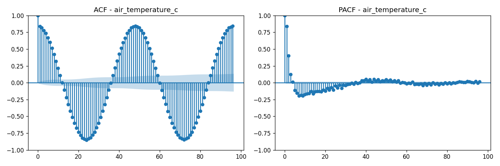
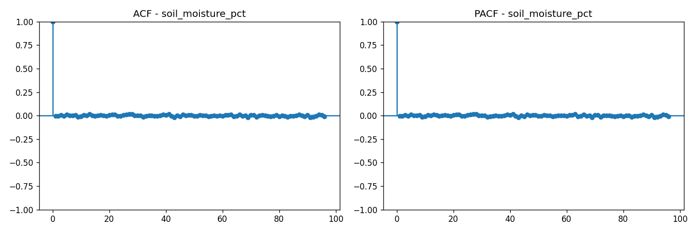
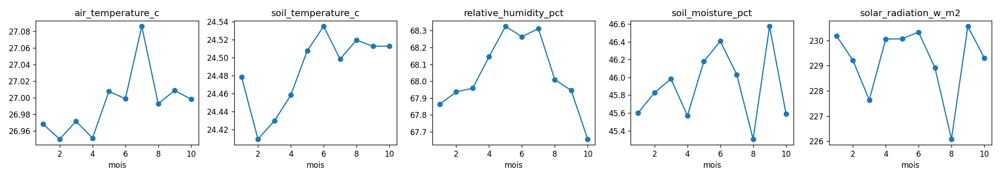
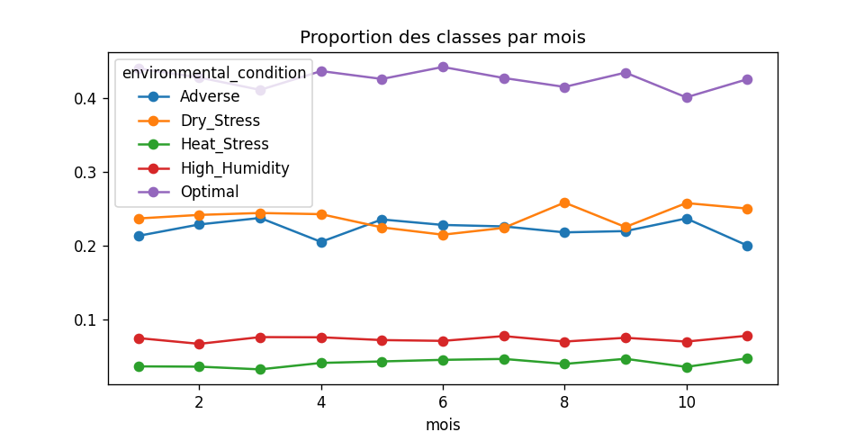
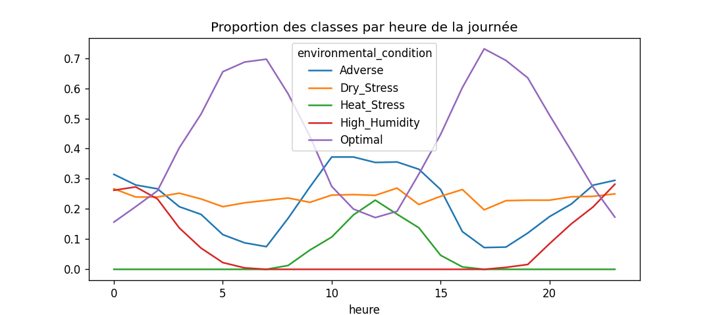

# Time-Series Exploration and Decision Gate

Student 3 | Master 1 mini-project: Precision agriculture monitoring using machine learning models

## Summary of findings

- Timestamps are valid, unique and regular (30 minutes). Sensor, zone and position metadata are unreliable, so spatial cross-validation (GroupKFold) and out-of-group analyses across sensors and zones are removed.
- Seven variables show a temporal dependence driven by a 24-hour cycle (air and soil temperature, relative humidity, solar radiation, light, evapotranspiration, leaf wetness). Soil moisture, pressure, rainfall, NPK and wind show none. All series are stationary, with no monthly seasonality and no target drift.
- The target has a strong daily cycle (for example Heat_Stress around noon, High_Humidity at night), and no variable precedes another or the target: all relations are at lag 0.
- Decision: temporal cross-validation is feasible but not strictly necessary. The mandatory protocol is the stratified 10-fold cross-validation repeated 3 times; a TimeSeriesSplit is kept as a complementary scheme.
- Outputs: a locked test set (last 3,000 records), a development set of 11,952 records with a 24-hour gap before the test set, 30 stratified folds, 5 temporal folds and 6 temporal features (hour sine and cosine, lags 1 and 2 of air temperature and relative humidity).

## 1. Scope and data used

This section reports the temporal audit (Week 1) and the temporal features and split generation (Week 2). The dataset has 15,000 records and 32 columns, from 2024-01-01 00:00 to 2024-11-08 11:30. All numerical results are stored in `results/Exploratory_temporal.csv` (148 rows) and all figures in `figures/`. Analyses use the global series ordered by timestamp. Monthly analyses use January to October only, because November contains only 8 days of data.

The target is `environmental_condition` (five classes): Optimal 42.6%, Dry_Stress 23.7%, Adverse 22.4%, High_Humidity 7.3% and Heat_Stress 4.0%. The imbalance ratio between the largest and the smallest class is about 10.6:1.

## 2. Timestamp quality

| Check | Result |
|---|---|
| Invalid or missing timestamps | 0 |
| Duplicated timestamps | 0 |
| Sampling interval | 30 minutes for 100% of consecutive records (minimum = maximum) |
| Chronological order | Records already sorted |
| Coverage | 312 days (15,000 records x 30 min = 312.5 days) |

Timestamps are valid, unique and perfectly regular. Temporal analysis and temporal validation are therefore technically feasible.

## 3. Reliability of sensor, zone and position metadata

The dataset contains 30 sensors (453 to 553 records each) and 5 zones (2,924 to 3,055 records each). Each of the 30 sensors appears in all 5 zones, with about 100 records per zone. Sensor SN_001, for example, has 501 records and 500 distinct latitude values, i.e. a new position at almost every record. Since all 15,000 timestamps are unique, exactly one sensor reports at each 30-minute step.

Consequently, `sensor_node_id`, `field_zone` and the coordinates do not describe stable physical locations. They are not reliable as grouping variables. Following the project protocol, spatial cross-validation (GroupKFold) and out-of-group generalization analyses are removed from the study design, and this is reported in the limitations.

## 4. Temporal dependence and stationarity

The ADF test indicates that all 20 continuous variables tested are stationary (p < 0.001), so there is no long-term trend. The Ljung-Box test (lag 48, i.e. 24 hours) shows temporal dependence for seven variables (p < 0.001), all driven by the daily cycle. The partial autocorrelation (PACF) shows a short direct memory (lags 1 and 2).

| Variable | Ljung-Box p | PACF lag 1 | PACF lag 2 |
|---|---|---|---|
| air_temperature_c | < 0.001 | 0.837 | 0.403 |
| soil_temperature_c | < 0.001 | 0.777 | 0.398 |
| relative_humidity_pct | < 0.001 | 0.682 | 0.378 |
| solar_radiation_w_m2 | < 0.001 | 0.921 | 0.306 |
| light_intensity_lux | < 0.001 | 0.902 | 0.336 |
| evapotranspiration_mm | < 0.001 | 0.936 | 0.308 |
| leaf_wetness_pct | < 0.001 | 0.279 | 0.210 |
| nitrogen_mg_kg | 0.025 | 0.005 | -0.002 |

Nitrogen is not considered temporally dependent: its PACF is close to zero at all lags, and with 20 tests performed one false positive at the 5% level is expected. The remaining 12 variables show no significant dependence (for example soil_moisture_pct p = 0.397, atmospheric_pressure_hpa p = 0.534, rainfall_mm p = 0.455; co2_ppm is borderline at p = 0.051).

For air temperature, the autocorrelation is 0.837 at lag 1 and 0.848 at lag 48, and about -0.85 near lag 24 (read from the plot), which reveals a 24-hour cycle. For soil moisture, the lag-1 autocorrelation is -0.005 and the ACF/PACF behave like white noise (Figures 1 and 2).



*Figure 1. ACF (left) and PACF (right) of air_temperature_c, lags 0 to 96 (two days). The ACF oscillates with a period of 48 steps (24 h); the PACF is large only at lags 1 to 3.*



*Figure 2. ACF (left) and PACF (right) of soil_moisture_pct: all bars stay close to zero at every lag (white noise).*

## 5. Daily and seasonal patterns

Daily cycle: the mean air temperature varies from 20.8 C at 00:00 to 33.1 C at 12:00. Soil moisture shows no systematic daily pattern.

Monthly pattern (January to October): monthly means are almost constant, and the Kruskal-Wallis test does not detect any month effect (Figure 3).

| Variable | Relative range of monthly means | Kruskal-Wallis p |
|---|---|---|
| air_temperature_c | 0.5% | 0.9997 |
| soil_temperature_c | 0.5% | 0.9998 |
| relative_humidity_pct | 1.0% | 0.931 |
| soil_moisture_pct | 2.8% | 0.387 |
| solar_radiation_w_m2 | 2.0% | 1.000 |

There is a strong daily cycle and no monthly seasonality. With only 10 months of data, an annual seasonality cannot be assessed.



*Figure 3. Monthly means of five variables, January to October. The vertical axes are zoomed: the largest variation is below 3% of the mean.*

## 6. Target: drift and daily cycle

Target drift. The class distribution is stable across months (chi-square test month x class, January to October: p = 0.526). Monthly proportions stay within these ranges: Adverse 0.205 to 0.237, Dry_Stress 0.215 to 0.258, Heat_Stress 0.032 to 0.047, High_Humidity 0.067 to 0.077, Optimal 0.401 to 0.442. No target drift is detected (Figure 4).



*Figure 4. Monthly proportion of each class (November contains only 8 days of data).*

Daily cycle of the target. The class distribution depends strongly on the hour of the day (chi-square test hour x class: p < 0.001, Figure 5):

- Heat_Stress is essentially absent outside 08:00 to 16:00 and peaks at 12:00 (22.9%).
- High_Humidity is essentially absent between 06:00 and 18:00 and peaks at 23:00 (28.2%).
- Optimal peaks at 06:00 to 07:00 (about 70%) and at 17:00 (73.1%).
- Adverse peaks between 10:00 and 13:00 (up to 37.2%).
- Dry_Stress stays between 19.7% and 26.9% at all hours.



*Figure 5. Proportion of each class by hour of the day: a strong daily cycle for Heat_Stress, High_Humidity, Optimal and Adverse; Dry_Stress stays flat.*

The probability that two consecutive records have the same class is 0.358, against 0.294 expected under independence. This weak persistence is explained by the daily cycle: if the classes were independent given the hour of the day, the expected probability would be about 0.358, which equals the observed value. There is no evidence of a memory between classes beyond this cycle.

## 7. Cross-correlation and lead-lag relationships

Within a window of plus or minus 6 hours (12 steps), the best lag is 0 for every pair tested, and the correlation at the best lag equals the correlation at lag 0.

| Pair (x to y) | Best lag | Correlation |
|---|---|---|
| solar_radiation_w_m2 to air_temperature_c | 0 | 0.819 |
| air_temperature_c to relative_humidity_pct | 0 | -0.766 |
| air_temperature_c to soil_temperature_c | 0 | 0.961 |
| relative_humidity_pct to leaf_wetness_pct | 0 | 0.637 |

An initial search over plus or minus 24 hours returned lags of +24 and -24 with a reversed sign. This is an artefact of the 24-hour periodicity (correlation alternates between positive and negative every 12 hours) and not a genuine lead-lag; the search was therefore restricted to 6 hours. For the target (search over plus or minus 24 hours), the best lag is also 0: air temperature versus the Heat_Stress indicator (r = 0.352) and relative humidity versus the High_Humidity indicator (r = 0.471). No variable precedes another variable or the target; the class is determined by the conditions at the same instant.

## 8. Decision gate: is temporal cross-validation appropriate?

| Criterion | Evidence | Verdict |
|---|---|---|
| Timestamp quality | Regular 30-min grid, no duplicates, sorted | Supports feasibility |
| Temporal dependence | Strong for 7 variables (daily cycle), none for 12 others; weak for the target | Partial |
| Non-stationarity or drift | All series stationary, no target drift, no monthly seasonality | Does not require it |
| Intended generalization | Classification of the current state from simultaneous sensor readings, not forecasting | Does not require it |
| Spatial metadata | Unreliable | GroupKFold removed |

Decision. Temporal validation is feasible but not strictly necessary. The mandatory protocol is the stratified 10-fold cross-validation repeated 3 times. A TimeSeriesSplit is kept as a complementary scheme to check robustness across periods, because consecutive records are strongly correlated (autocorrelation 0.84 at lag 1 for air temperature), which could inflate the scores of random splits. Spatial cross-validation and out-of-group generalization across sensors and zones are removed; robustness across time periods is assessed with the TimeSeriesSplit.

## 9. Temporal feature engineering

Features are computed in `src/temporal_features.py` using only past observations (positive shifts) on the global series, and none uses the target:

- `heure_sin` and `heure_cos`: cyclical encoding of the time of day (justified by the daily cycle of the features and of the target).
- lag 1 and lag 2 (30 and 60 minutes) of `air_temperature_c` and `relative_humidity_pct`: justified by their strong PACF at lags 1 and 2; they drive the Heat_Stress and High_Humidity classes.
- No temporal features for variables without temporal dependence (soil moisture, pressure, rainfall, NPK, wind, battery, signal).

The first record has a missing lag 1 and the first two records have a missing lag 2; these values are left to the imputation step of the pipeline. Other dependent variables (soil temperature, radiation, light, evapotranspiration, leaf wetness) are strongly correlated with the two selected ones and remain candidates for the feature selection step.

Rolling statistics and differences were not built: the PACF shows a direct memory limited to the first two lags, which the lag features already capture, and the daily cycle is encoded by sine and cosine. No time-since-event feature applies, since rainfall shows no temporal dependence and the irrigation variables are removed as target leakage. The project guidelines recommend computing features per sensor node; this was not possible here because the sensor identifier does not correspond to a stable location and each sensor reports only about once every 10 hours, so the lags are computed on the global series ordered by timestamp (see Limitations). The temporal features file is indexed by the original row number, so that it can be joined to the development set.

## 10. Splitting protocol

- Locked test set: the last 3,000 records (2024-09-07 00:00 to 2024-11-08 11:30), used only for the final evaluation.
- Development set: 11,952 records (2024-01-01 00:00 to 2024-09-05 23:30). The 48 records (24 hours) between the development set and the test set are discarded to avoid contiguity between training and test data.
- Class proportions in development and test sets are close (computed on the initial split before the 24-hour gap: Optimal 0.428 vs 0.415, Heat_Stress 0.040 vs 0.041).
- Main scheme: RepeatedStratifiedKFold, 10 folds x 3 repetitions, `random_state = 42` (about 1,195 validation records per fold). Validation indices are saved to disk and shared by all groups.
- Complementary scheme: TimeSeriesSplit with 5 folds and a gap of 48 steps (24 hours); each validation fold has 1,992 records and the training size grows from 1,944 to 9,912 records. This scheme is not stratified.

## 11. Limitations

1. Temporal features are computed on the global series because sensor metadata are unreliable. The protocol asks for per-sensor features; this deviation is a consequence of the data and consecutive records come from different sensors and zones.
2. The data cover only 10 months (November is partial), so annual seasonality and generalization to other seasons cannot be evaluated. The test set covers only September to November.
3. Temporal dependence tests use a single lag (48), 20 tests were run without multiple-testing correction, and ADF p-values are reported as p < 0.001.
4. Several patterns suggest that the data may be simulated (month-to-month p-values close to 1, lead-lag relations exactly at lag 0, sensor positions changing at every record). Conclusions may not transfer to real deployments.
5. Spatial cross-validation and out-of-group generalization across sensors and zones were not performed because the metadata are unreliable. A validation by groups of periods (for example leave-one-month-out) was not performed either; robustness across time periods relies on the TimeSeriesSplit.
6. The temporal cross-validation is not stratified, and its first fold is trained on only 1,944 records, so its scores are expected to be lower and more variable.
7. Lag features were built for two variables only; other temporally dependent variables are left to feature selection.
8. Potential target leakage from some variables (for example the irrigation variables) is handled in the dataset audit and not in this section.

Note on the exploratory scope. The exploratory temporal statistics were computed on the whole series, including the period later used as the locked test set. They are descriptive and no model parameter is learned from them; the temporal features depend only on timestamps and past feature values.

## 12. Reproducibility

All stochastic operations use `random_state = 42`. Running `make_splits.py` twice produced identical files. Deliverables of this part: `results/Exploratory_temporal.csv`, `figures/` (five figures), `src/make_splits.py` (outputs `dev_index.csv`, `test_index.csv`, `splits_validation.csv`, `splits_temporel.csv` in `results/splits/`) and `src/temporal_features.py` (output `results/temporal_features.csv`). The `index` columns refer to the row index of the original CSV file: do not sort, filter or drop rows before using them.

To reproduce this part, run the following commands from the repository root:

```bash
python src/make_splits.py data/precision_agriculture_dataset.csv
python src/temporal_features.py data/precision_agriculture_dataset.csv
```

The versions of Python and of the libraries used (pandas, NumPy, SciPy, scikit-learn, statsmodels, matplotlib) are recorded in the common `requirements.txt`.

## Where this content goes in the group report

| Sections of this document | Section of the mandatory report structure |
|---|---|
| 1 to 7 | 6. Dataset and Features (audit) |
| 8 and 10 | 7. Experimental Protocol (cross-validation, splits) |
| 9 | 5. Architecture (pipeline) |
| 11 | 14. Limitations |
| 12 | Appendices (reproducibility) |
